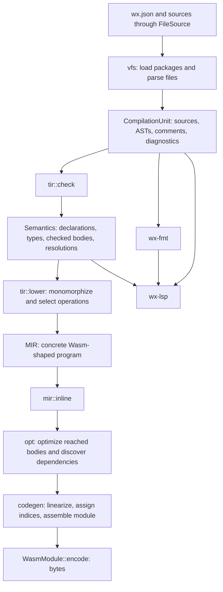

# How wx-compiler works

`wx-compiler` is a library for understanding WX programs and compiling them to
WebAssembly. Its stages expose different products so that callers can stop at
the level they need. The CLI drives a complete build; the formatter consumes
syntax; the language server consumes syntax and semantic information.

These boundaries are modules and data contracts within one compiler crate.
The surrounding tools are separate crates that depend on it. Keeping a boundary
clear means keeping its inputs, output, and responsibility clear.

## The representations and their consumers

| Representation | Question it answers | What belongs here |
| --- | --- | --- |
| AST | What did the author write? | Syntax, source spans, written names and types. |
| `CompilationUnit` | Which parsed files and packages form this compilation? | Source files, package/module relationships, comments and loading/parsing diagnostics. |
| `Semantics` / TIR | What does this program mean? | Resolved declarations, interned types, generic signatures, checked bodies, constants and name references. |
| MIR | How does the concrete program execute? | Function instances, scalar operations, control flow, memory accesses and module resources. |
| Optimizer graph | Which computations are needed, and where can they execute? | Value dependencies, effects, joins and placement decisions for one function. |
| `wasm::Function` / `WasmModule` | Which instructions and sections are encoded? | Flat stack-machine instructions and the module's output index spaces. |

Each transition resolves decisions needed by later stages. Source syntax remains
available for formatting and editor requests even though the backend no longer
needs it. Checking is useful independently of whether every accepted construct
has been implemented in lowering.

## Loading and syntax: vfs, ast, symbols

[`vfs`](src/vfs/mod.rs) assembles compilation inputs. `open_manifest` resolves a
package directory's `wx.json`, its entry file, local dependencies, and modules.
`CompilationUnitBuilder` loads files and calls the parser, producing an owned
`CompilationUnit`. The lower-level builder also supports tests that construct
packages directly without manifests.

Reading goes through `FileSource`: native files, virtual maps, and the embedded
core share the same loading interface. The LSP supplies its own overlay to read
unsaved editor text before falling back to disk. This keeps package resolution
and parsing reusable across command-line tools, tests, and editor sessions.
Path types distinguish absolute locations from paths relative to a manifest.

[`ast`](src/ast/mod.rs) contains the lexer, recursive-descent parser with Pratt
expression parsing, and the syntax tree. Parsing a file returns `Parsed`:
`AST`, `CommentMap`, and diagnostics. The compilation stores these in separate
tables indexed by `FileId`: checking reads trees, while formatting also needs
comments and original source text. The AST records syntax structurally; it is
not a lossless token tree that alone reproduces every byte of the input.

Nodes are stored in per-file arenas and accessed by typed IDs; variable-length
children occupy shared list storage. Source positions remain available for
diagnostics and editor queries. Error recovery retains useful structure, such
as an incomplete member access, so editing unfinished code can still produce
semantic information.

[`symbols`](src/symbols.rs) provides the shared string interner and keyword
identities. The caller creates it with `Keyword::create_interner` and passes
the same interner through loading, checking, and later consumers. Symbols are
compact identities whose text is resolved through that interner. An LSP snapshot
must keep the matching interner with its compilation and semantic state.

## Meaning: tir

[`tir::check`](src/tir/mod.rs) builds `Semantics`, the owned result of semantic
analysis. TIR includes both the data describing the checked program and the
machinery that constructs and queries it. It preserves generic source-level
meaning; monomorphization happens when lowering to MIR.

The main responsibilities are grouped as follows:

| Files under `src/tir/` | Responsibility |
| --- | --- |
| `decls.rs`, `imports.rs`, `paths.rs` | Register declarations and namespaces; resolve paths and imports with the language's visibility rules. |
| `impls.rs`, `members.rs` | Index impl candidates and select members through concrete types or trait bounds. |
| `signatures.rs` | Own `Semantics`; construct signatures, schedule their queries and coordinate checking phases. |
| `types.rs`, `bounds.rs` | Intern types, substitute generic arguments, and represent generic identities and assumptions. |
| `solver.rs`, `satisfaction.rs` | Normalize associated types, select impls and prove requirements using those assumptions. |
| `obligations.rs`, `conformance.rs` | Check recorded requirements and whether impl members satisfy their trait contracts. |
| `body.rs`, `typecheck.rs`, `typecheck/` | Represent and check expressions, lexical scopes, locals, places, calls and patterns. |
| `operators.rs`, `intrinsics.rs`, `usefulness.rs` | Describe operator dispatch and compiler-known operations; analyze pattern coverage and unreachable arms. |
| `eval.rs`, `numbers.rs`, `literals.rs`, `layout.rs` | Evaluate constants, interpret literals and determine physical memory layouts. |
| `resolutions.rs`, `format.rs` | Record what written names refer to and format semantic types and bounds for consumers. |
| `lower.rs`, `lower/` | Translate checked meaning into concrete MIR. |

### Construction, queries and owned results

Checking first registers declarations, resolves imports, and builds the impl
index. `SemanticsBuilder` then constructs signatures on demand, tracking
dependencies and cycles. It builds constant bodies before evaluation can read
them, checks declaration obligations, checks/evaluates constants, checks
function bodies and global initializers, and resolves exports.

This ordering lets declarations refer to other declarations while keeping
signature construction separate from proving its requirements. Constant bodies
initially defer checks that require values; evaluation reads the checked bodies
without constructing syntax-dependent state recursively.

`SemanticsBuilder` borrows syntax and exists only during construction.
`Semantics` owns declarations, types, bodies, resolutions, values, diagnostics,
and solver state without borrowing the AST. It remains live and mutable: queries
may intern normalized types or populate caches after the initial check. This
ownership lets the LSP store `CompilationUnit`, `StringInterner`, and `Semantics`
side by side without self-referential borrows.

The solver handles normalization, impl selection and evaluation as interacting
queries. Query failures describe why there is no answer; the construct requiring
that answer owns the diagnostic. This supports recovery without emitting the
same underlying error at every downstream use.

### Bodies and representations

A checked `Body` keeps typed expressions, scopes, locals, labels, memory places,
and patterns. `BodyBuilder` translates syntax; `BodyContext` decides requirements
on the resulting body. Functions, constants and global initializers share this
machinery, keeping expression rules consistent across owners.

Memory layout and stack representation answer different questions. `layout.rs`
decides byte offsets and alignment for allocations, loads and stores. Stack-value
queries and `lower/shapes.rs` describe the Wasm values carrying a WX value. A
struct's physical field order can differ from declaration order; its flattened
values must still preserve their meaning. Evaluation and lowering share layout
decisions so compile-time data and runtime accesses agree.

## Concrete execution: lowering and MIR

`tir::lower(&mut sema, &strings)` builds MIR using existing checked bodies and
semantic queries. Its worklist identifies a function instance by its declaration
and type arguments. A generic function gets a concrete instance when needed;
trait calls select their concrete implementation, and compiler-provided
operations become backend operations. Aggregate values are split into scalars,
and memory accesses receive their offsets, widths and memory identities.

This boundary is where WX's richer types become explicit execution decisions.
Later stages do not repeat source-level inference or trait resolution. Lowering
reports unsupported constructs on `Semantics`; a successful check alone does
not establish that a program builds.

[`mir`](src/mir/mod.rs) owns concrete functions, globals, memories, imports,
exports, signatures and static data. Each function has an arena-backed expression
body with structured control flow and explicit locals. Locals and parameters
are scalar; multi-result expressions can carry several scalars together.
Typed MIR IDs distinguish these instances from source declarations and from
eventual Wasm indices.

`mir/inline.rs` rewrites calls over this representation while preserving item
IDs. `mir/references.rs` enumerates dependencies, giving reachability one shared
way to discover what a body or module item uses. Keeping optimization in MIR
allows later passes to inspect and rewrite the result before encoding.

## Optimization: opt

[`opt`](src/opt/mod.rs) transforms MIR back into MIR through a per-function
value/effect graph. Pure computations are represented by dependencies; effects
and structured control flow constrain where operations can execute.

The sequence is graph construction (`build`), use collection (`uses`), control
locations (`locations`, with dominance support in `dominators`), placement
planning (`placement`), and MIR emission (`emit`). `optimize_function` replaces
one function's body after its temporary graph and planning storage expire.
Separating these steps lets tests examine graph and placement invariants
independently of binary encoding.

`optimize_reachable` starts at exports and the start function. It optimizes each
reached body before following its dependencies, so an eliminated call or memory
access need not retain the resource it previously referenced. The returned
`Reachability` marks select functions, globals, memories and static data for
codegen; unreachable entries remain in MIR, preserving IDs. Changing bodies or
roots afterwards can invalidate those marks.

## Encoding: backend, codegen and wasm

[`backend::emit`](src/backend.rs) is the shared orchestration point: optional
inlining, optimization/reachability, then code generation. The CLI and execution
tests use this same sequence. Disabling inlining still runs optimization.

[`codegen/linearize.rs`](src/codegen/linearize.rs) walks structured MIR into a
flat `wasm::Function`, with explicit stack instructions, branches and locals.
[`wasm`](src/wasm/mod.rs) supplies this instruction vocabulary.
[`codegen`](src/codegen/mod.rs) assigns Wasm indices, orders imports before
definitions, lays out retained static data, and assembles module sections.
`WasmModule::encode` writes the binary bytes. Keeping output indices separate
from MIR IDs lets codegen omit unreachable items without rewriting the program's
internal identities.

## Core and shared infrastructure

[`core/main.wx`](core/main.wx) expresses primitives, traits and typed
instruction declarations in WX. The checker recognizes required core items and
compiler rules supply operations the language cannot implement in ordinary WX.
This combines library-defined abstractions with an explicit platform boundary.
[`build.rs`](build.rs) embeds core sources, and `CoreFileSource` serves them
through the ordinary loader. Loading core therefore needs no installed source
directory, and editor navigation can still address its virtual files.

[`diagnostics`](src/diagnostics.rs) shares codes, byte offsets, source spans,
and severity classification. Loading/parsing diagnostics stay on
`CompilationUnit`; checking/lowering diagnostics stay on `Semantics`. Callers
gather both and choose how to display them. Parser recovery and semantic error
nodes allow useful partial results; lowering requires successful semantic
checking, and build callers must also check input diagnostics.

Private helpers `index.rs` and `small_vec.rs` implement typed table indices and
a small nonempty list. Arena storage keeps ownership explicit and related data
in dense tables; typed IDs prevent accidentally indexing a different kind of
table. Those IDs belong to their owning compilation, body or interner and are
not persistent identities across independently rebuilt snapshots.

Test-only `testing` provides diagnostic assertions. Tests live alongside the
stages they exercise; `backend_tests` also builds MIR directly and executes it
under Wasmtime. Syntax, semantic checking, MIR transformations and execution can
thus be tested at separate boundaries.

## How tools use the boundaries

| Consumer | Compiler products it needs | Responsibility it keeps |
| --- | --- | --- |
| `wx check` | Compilation inputs and `Semantics` | Command-line diagnostics and exit status. |
| `wx build` | Checking, lowering and backend output | Output selection and writing bytes. |
| `wx-fmt` | AST, comments, source text and symbols | Document construction and layout/rendering. |
| `wx-lsp` | Parsed inputs, semantic data and shared semantic queries | Editor documents, project refresh, request queries and protocol conversion. |

[`wx_fmt::format`](../wx-fmt/src/lib.rs) does not need `Semantics`, MIR or code
generation. It can format a syntactically valid file even when its types do not
check. It reuses literal-decoding helpers exported by the compiler, but does not
run semantic analysis. CLI and LSP formatting share this formatter and manifest
configuration.

The LSP's [`Snapshot`](../wx-lsp/src/snapshot.rs) owns matching parsed inputs,
symbols and semantic state for one analyzed root. Syntax identifies the written
construct at the cursor; semantic data supplies its meaning. Name references
are recorded by checking in `Semantics::resolutions`, while declarations remain
in their owning tables. Navigation and reference queries in
[`wx-lsp/query.rs`](../wx-lsp/src/query.rs) read those decisions. Queries that
must agree with language rules, such as member availability and normalization,
stay in the compiler. The server adapts their results to editor requests.

When adding functionality, place syntax in AST, language meaning in TIR,
concrete execution in MIR, transformations in `opt`, and output encoding in
`codegen`. Let tools reuse the earliest representation containing their answer.
For example, a syntax change can affect the formatter; a resolution change can
affect navigation; a lowering-only change should not require editor analysis
to run code generation.
